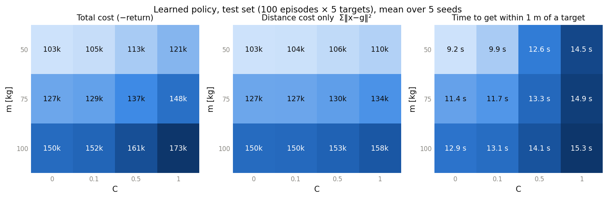
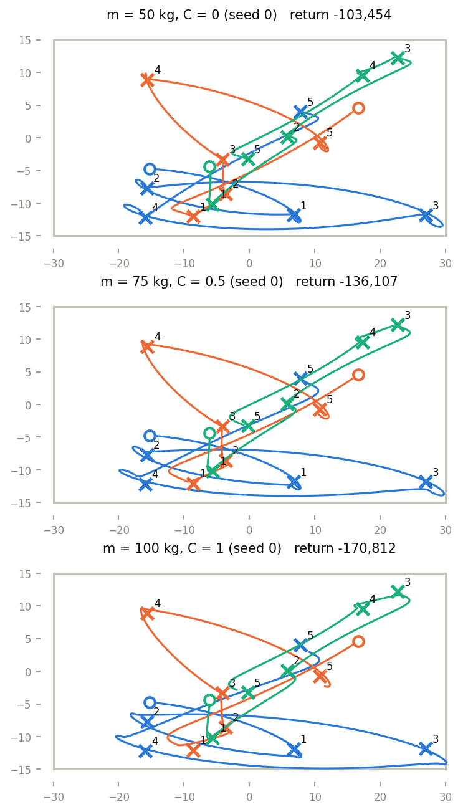
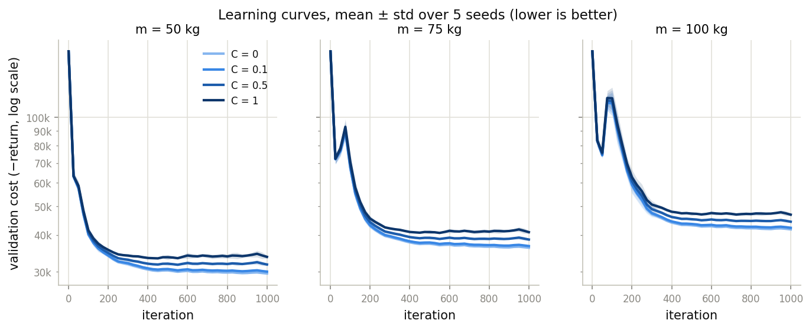
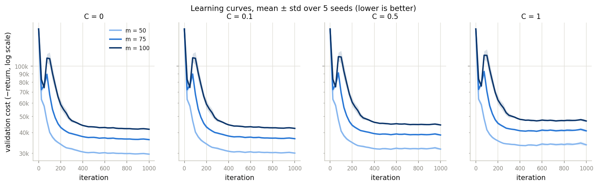

# Robots on Ice: continuous control with policy gradient

Final project **PG-1** for *Reinforcement Learning, AA 2025-26* (University of Milan).
A robot on a frictionless ice rink learns to reach a sequence of targets with a linear Gaussian
policy trained by **GPOMDP with a time-dependent baseline** (the finite-horizon policy gradient of
the course), written from scratch in numpy. The final return and the learning curves are compared
across robot masses m and energy weights C.

Every number below is read from a file in `results/`, and every figure is drawn from those files
by `experiments/make_plots.py`. `bash run_all.sh` regenerates all of them from scratch.

## 1. Problem and physics

A holonomic robot on a 60 × 30 m rink (`x ∈ [−30, 30] × [−15, 15]`) gets **20 s per target**
and decides **10 times per second** (dt = 0.1 s):

```
x(t+1) = x(t) + 0.1 · v(t)
v(t+1) = v(t) + 0.1 · F(t) / m          ‖F‖ ≤ 100 N
penalty per step:  ‖x(t) − g‖²  +  C/100 · ‖F(t)‖²
```

The tasks: (1) model it as an MDP, (2) choose a parametric policy, (3) train it with a policy
gradient method and tune the hyperparameters, (4) compare the final return and the learning curves
for m ∈ [50, 100] kg and C ∈ [0, 1].

## 2. MDP formulation (task 1)

| Element | Choice | Why |
|---|---|---|
| State | `s = (x − g, v)` ∈ ℝ⁴, observed as `[(x−g)/30, v/10]` | Markov: the next state and the reward depend only on s and F. The error relative to the target makes one policy work for every target. The scaling puts all features in about [−1, 1]. |
| Action | `a ∈ ℝ²` in units of 100 N; the env applies `F = 100·a / max(1, ‖a‖)` | Continuous actions. The policy is an unconstrained Gaussian; the env enforces the force limit, keeping the direction. |
| Reward | `r = −(‖x−g‖² + C/100·‖F‖²)`, from x(t), F(t) before the update | Exactly minus the task's penalty. |
| Initial state | random start (v = 0) and random targets, uniform in the rink with a 2 m margin | The initial-state distribution p₀. |
| Horizon | **finite**, T = 200 steps per target, **no discount**; train on 1 target, evaluate on sequences of 5 | Each target lasts exactly 20 s, so this is the finite-horizon (episodic) setting of the course, with return `R(τ) = Σ_{t<T} r_t`. |
| Evaluation | the same 100 test episodes × 5 targets for every policy (seed 12345), mean action | Tuning and training-time monitoring use separate validation episodes (seed 777). |

## 3. Policy and algorithm (tasks 2 and 3)

### 3.1 Linear Gaussian policy (`src/policy.py`)
`a ~ N(K s + b, diag(σ²))`, with K ∈ ℝ^{2×4}, b ∈ ℝ², and log σ learned (clamped to
[log 0.05, log 2]): 12 parameters, initialised at K = 0, b = 0, σ = 2.0.

- The mean is linear in the state, like a spring-damper controller: negative gains push towards
  the target and against the velocity. Few parameters, each with a physical meaning.
- The Gaussian explores, and its score function has a closed form (z = (a − μ)/σ):
  `∂log π/∂K_ij = (z_i/σ_i)·s_j`, `∂log π/∂b_i = z_i/σ_i`, `∂log π/∂log σ_i = z_i² − 1`.
  It is checked against finite differences in `tests/test_policy.py`.

### 3.2 GPOMDP with a time-dependent baseline (`src/gpomdp.py`)
With N = 64 episodes per iteration (simulated in parallel):

```
∇J(θ) ≈ (1/N) Σ_n Σ_t ∇log π(a_t^n | s_t^n) · (G_t^n − b_t),    G_t = Σ_{k≥t} r_k,    b_t = (1/N) Σ_n G_t^n
```

- **From REINFORCE to GPOMDP:** REINFORCE weights every action by the whole return R(τ). GPOMDP
  keeps only the rewards from t on: an action cannot change earlier rewards, and those terms have
  zero mean because `E[∇log π(a|s) | s] = 0`. So the estimate stays **unbiased** with **less
  variance**.
- **Baseline:** `b_t` does not depend on the action, so subtracting it is unbiased for the same
  reason, and it centres the weights, which lowers the variance. Summing the course's reward
  baseline `mean_n r_k` over k ≥ t gives exactly `mean_n G_t`; `tests/test_gpomdp.py` checks that
  this form equals the course's second form of the estimator.
- **Update:** Adam (lr 1e-2), as suggested in the course for practical PG. Before the step the
  weights are divided by their standard deviation: one positive number, so the gradient's
  direction is unchanged. Costs differ a lot between (m, C) and fall during training, and this
  keeps the step size comparable, so one learning rate works for the whole grid.

### 3.3 Hyperparameter tuning (`experiments/tune.py`)
Tuned at m = 75, C = 0.5 on validation episodes, 3 seeds × 1000 iterations each, starting from
lr 1e-2, batch 64, σ₀ = 0.5 and changing one thing at a time (`results/tuning_lr.csv`,
`results/tuning_other.csv`):

| Change | Validation return (mean ± std over seeds) |
|---|---|
| lr 3e-3 / **1e-2** / 3e-2 / 1e-1 | −37,139 ± 73 / **−31,674 ± 303** / −55,021 ± 37,917 / −1,146,568 ± 1,894,039 |
| batch 32 / **64** / 128 | −32,223 ± 631 / **−31,674 ± 303** / −31,791 ± 1,247 |
| σ₀ 0.25 / 0.5 / 1.0 / **2.0** | −33,286 ± 346 / −31,674 ± 303 / −30,697 ± 338 / **−29,800 ± 277** |

**Frozen for every other run:** lr 1e-2, batch 64, 1000 iterations, σ₀ = 2.0.
Larger learning rates are unstable (3e-2 fails on one seed; 1e-1 is worse on every seed and
diverges on one, with σ pushed to its upper clamp of 2). A batch of 128 doubles
the compute without improving the mean and varies more between seeds. A larger initial σ was better:
more exploration early, and σ is learned down anyway (to 0.33 on average for σ₀ = 2.0).

## 4. Results across m and C (task 4)

### 4.1 Final return (`experiments/run_grid.py`)
60 runs: m ∈ {50, 75, 100} × C ∈ {0, 0.1, 0.5, 1} × 5 seeds. Test set, mean ± std over seeds
(`results/summary.csv`):

| Return | C = 0 | C = 0.1 | C = 0.5 | C = 1 |
|---|---|---|---|---|
| m = 50 | −103,253 ± 863 | −105,072 ± 982 | −112,513 ± 1,737 | −121,057 ± 2,792 |
| m = 75 | −126,595 ± 1,138 | −128,612 ± 1,196 | −137,121 ± 1,888 | −147,611 ± 3,029 |
| m = 100 | −149,660 ± 1,275 | −151,955 ± 1,395 | −161,468 ± 2,282 | −173,425 ± 3,744 |

Returns for different C are **not directly comparable**, because the reward itself changes with C.
So the distance part of the cost (`Σ‖x−g‖²`, the same quantity for every C) and the time to reach
a target are reported separately:

| Distance cost / time to get within 1 m | C = 0 | C = 0.1 | C = 0.5 | C = 1 |
|---|---|---|---|---|
| m = 50 | 103,253 / 9.2 s | 103,746 / 9.9 s | 106,371 / 12.6 s | 109,957 / 14.5 s |
| m = 75 | 126,595 / 11.4 s | 127,051 / 11.7 s | 129,725 / 13.3 s | 134,096 / 14.9 s |
| m = 100 | 149,660 / 12.9 s | 150,183 / 13.1 s | 152,964 / 14.1 s | 157,677 / 15.3 s |



**What the numbers mean physically:**
- **A heavier robot does worse.** With ‖F‖ ≤ 100 N the top acceleration is 2 m/s² at 50 kg but
  1 m/s² at 100 kg, so it spends longer far from the target: at C = 0 the distance cost goes from
  103,253 (m = 50) to 149,660 (m = 100) and the time to reach a target from 9.2 s to 12.9 s.
- **A larger C means gentler pushing.** Force costs more, so the robot accepts being far away for
  longer, although distance is weighted the same: at m = 75 the distance cost rises from 126,595
  (C = 0) to 134,096 (C = 1), and the share of targets reached within 20 s falls from 0.87 to 0.575.
- **The two effects add up:** the cheapest setting is m = 50, C = 0 and the most expensive is
  m = 100, C = 1, for the total cost, the distance cost and the time to reach.



### 4.2 Learning curves
Validation cost (−return, 20 validation episodes, mean action) every 25 iterations, mean ± std over
the 5 seeds:




- **Mass sets the difficulty.** For a fixed C, after the first ~100 iterations the curves are
  ordered by mass, and the 100 kg robot's curves flatten last.
- **C changes the level, not the shape.** For a fixed mass the four curves almost overlap in the
  early iterations and then separate slightly, because larger C adds an energy term to the cost.
- **The early bump** (around iteration 50–100, largest for m = 100) is a likely spring-without-a-
  damper effect: the robots start at rest, so the velocity features are small at first and the
  damping gains are learned later than the position gains; until then the robot overshoots.
- Results vary little between seeds: the std over seeds of the final return is at most 3,744
  (m = 100, C = 1), about 2% of the cost.

## 5. Reproduce

```bash
python -m venv .venv
source .venv/bin/activate          # Windows (Git Bash): source .venv/Scripts/activate
pip install -r requirements.txt
pytest -q                          # 27 tests
bash run_all.sh                    # every result and figure, from scratch
```

`run_all.sh` runs, in order: the tests, `tune.py` (both stages), `run_grid.py --force`, and
`make_plots.py`. A full run took about 12 minutes on the development machine (12 logical CPU
threads, 4 parallel workers). Run in a fresh copy without `results/`, it reproduced all 331 saved
result files exactly (CSVs, JSONs, policies and trajectories).

Single run: `python experiments/train_single.py --m 75 --C 0.5 --seed 0`.
`make_plots.py` only reads `results/` and never trains, so the figures can be redrawn in seconds.

Developed and tested with Python 3.13.0 on Windows 11. The course specifies Python 3.11;
`requirements.txt` pins versions that support both, but 3.11 itself was not tested.
Every random quantity takes an explicit seed, so reruns on the same setup give the same numbers.

## 6. Repository layout

```
src/          config.py env.py policy.py optim.py gpomdp.py evaluate.py plotting.py
experiments/  tune.py train_single.py run_grid.py make_plots.py
tests/        test_env.py test_policy.py test_gpomdp.py test_evaluate.py
results/      runs/<m>_<C>_s<seed>/ (config.json, history.csv, policy.npz, trajectories.csv, eval.json)
              grid.csv summary.csv tuning_lr.csv tuning_other.csv tuning/ figures/
run_all.sh
```

## 7. Limitations
- **Stationary policy:** each target lasts a finite 200 steps, and the optimal policy of a
  finite-horizon MDP generally depends on time; like the course, we use a stationary policy for
  simplicity.
- **Linear policy:** the force limit makes the problem non-linear; a linear mean cannot represent
  e.g. full-force braking, and the paths overshoot and loop around some targets (figure above).
- **One tuning point:** the hyperparameters were tuned at m = 75, C = 0.5 only and frozen for the
  whole grid.
- The optional variants (friction, rink walls) are not part of this submission.
